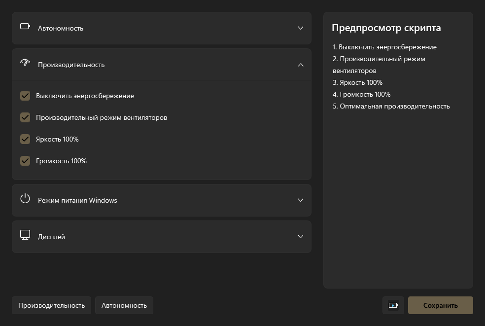

# Autonomy&Performance

**Автономность и производительность** — портативный конструктор тихих EXE для переключения параметров Windows 11. Выберите нужные действия, иконку и сохраните самостоятельный исполняемый файл. Установка, компилятор, PowerShell и дополнительные библиотеки на компьютере пользователя не нужны.



## Запуск

Скачайте [`Autonomy&Performance.exe`](Autonomy%26Performance.exe) через кнопку **Download raw file** на странице файла и запустите его в Windows 11 x64. Конструктор использует встроенный в Windows .NET Framework 4.8. Созданный EXE работает отдельно от конструктора и исходников.

## Возможности

- Включение и выключение энергосбережения.
- Тихий и производительный режим вентиляторов на поддерживаемых устройствах ASUS с ScreenXpert.
- Эффективный, сбалансированный и производительный режимы питания Windows.
- Яркость и громкость 100%, с сохранением отключения звука.
- Выбор дисплея и доступной для его текущего разрешения частоты обновления.
- Пресеты «Автономность» и «Производительность», редактируемый набор действий и копируемый предпросмотр.
- Пять встроенных иконок и пользовательский `.ico`.

Интерфейс на русском языке, в тёмном стиле Windows 11, с системными шрифтами, акцентным цветом и Mica при поддержке системой. Пресеты меняют только будущий скрипт; параметры компьютера применяются при запуске сохранённого EXE.

## Портативность и ограничения

Программа не сохраняет собственные настройки, не устанавливает службы, задачи или ассоциации. EXE собирается в памяти, без Windows UpdateResource и его дополнительных временных файлов. Для безопасного сохранения используется один временный файл в выбранной пользователем папке; при штатном завершении он удаляется или заменяется готовым EXE. В системных диалогах отключены добавление в недавние документы и пробное создание сохраняемого файла. Windows, .NET Framework и оболочка всё ещё могут обслуживать собственные кэши и историю. Это не обещание полного отсутствия системных записей.

Аппаратно недоступные действия пропускаются. Поддержка энергосбережения основана на внутреннем механизме Windows 11; совместимость с будущими версиями системы не гарантируется. Отсутствие ScreenXpert не препятствует остальным действиям. Готовые EXE не показывают интерфейс, консоль, запрос UAC или собственные уведомления.

Подробные результаты и границы проверки — в [отчёте о портативности](Tests/PORTABILITY-RESULTS.md). Отсутствие любых записей реестра не заявляется.

## Сборка и проверки

Исходники находятся в [`Source`](Source), описание интерфейса — в [`Source/DESIGN.md`](Source/DESIGN.md), подробности работы — в [`Source/README.md`](Source/README.md).

Из корня проекта в **Windows PowerShell 5.1**:

```powershell
.\Source\Build.ps1 -SkipPresets
```

Используется системный компилятор .NET Framework. Сборка обновляет только `Autonomy&Performance.exe`; промежуточные файлы остаются в `Source/Build` и не публикуются.

Версия конструктора имеет вид `0.0.0.N`, где `N` — порядковый номер коммита (`git rev-list --count HEAD`). Для сборки перед предстоящим коммитом передайте его номер явно: `-CommitNumber N`. Перед публикацией каждого изменения пересобирайте корневой EXE с номером создаваемого коммита; сам коммит затем включает исходники и этот EXE. У экспортированных скриптов сведения о версии удалены.

Проверки экспорта и интерфейса не требуют применения системных режимов:

```powershell
.\Tests\VerifyExport.ps1
powershell.exe -NoProfile -STA -File .\Tests\VerifyUi.ps1
powershell.exe -NoProfile -STA -File .\Tests\VerifyPresets.ps1
powershell.exe -NoProfile -STA -File .\Tests\VerifyOverlayScroll.ps1
```

Проверки с названиями `VerifyFunctional` и `VerifyDisplay` действительно меняют системные параметры с последующим восстановлением. Не запускайте их одновременно с ручной настройкой компьютера. Локальные отчёты и трассы исключены из репозитория; выполненные проверки и ограничения описаны в [`Tests/RESULTS.md`](Tests/RESULTS.md).
